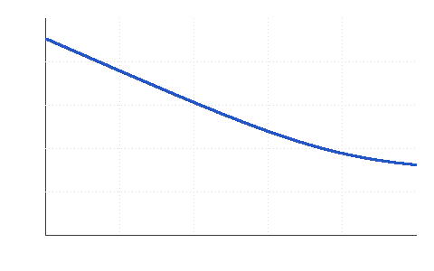

# 2026-01-15 (Thursday)

> **Sample note.** Everything in `examples/` is fictional and exists only to show the format. Delete the folder in your own copy.

## To do today
- [x] Short the ADC inputs and log 10 minutes of data
- [>] Compare against the datasheet noise table (carried to 2026-01-16)
- [>] Re-run with the reference buffer bypassed #todo (carried to 2026-01-16)

## Log
- 09:10 Inputs shorted at the connector, board on the bench supply, lid closed.
- 09:25 Logged 10 min at 10 SPS. Raw data kept out of the repo; summary in `data/noise-density.csv`.
- 10:05 Input-referred noise looks higher than expected below 3 Hz.

## Measurements / results

Thermal noise of the source resistance sets the floor:

$$e_n = \sqrt{4 k T R \,\Delta f}$$

For $R = 10\,\mathrm{k\Omega}$ at 300 K that is about $12.9\,\mathrm{nV}/\sqrt{\mathrm{Hz}}$.

| Frequency | Measured (nV/√Hz) | Note |
|-----------|------------------:|------|
| 0.1 Hz | 720 | 1/f dominated |
| 3 Hz | 170 | corner |
| 100 Hz | 41 | white floor |

## Ideas / questions
- Is the low-frequency excess the reference buffer or the supply? #noise
- Try battery supply to separate the two.

## References
- Datasheet noise table (see project notes)
